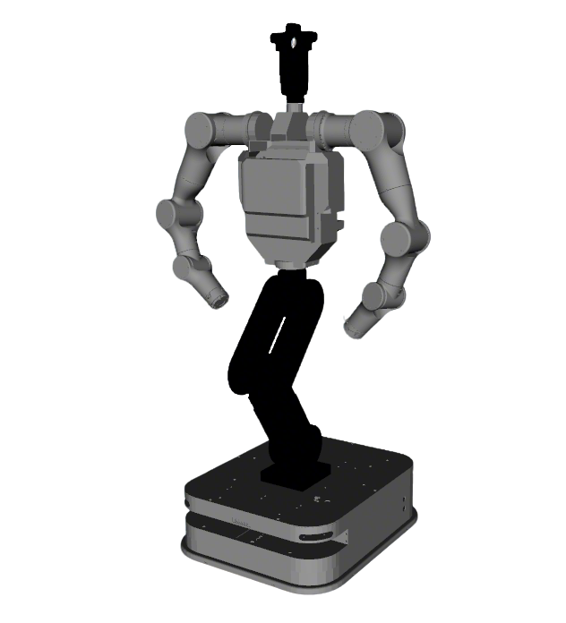

# FiveAges W1 Description

This package contains the description files for FiveAges W1 humanoid.

## 1. Build
```bash
cd ~/ros2_ws
colcon build --packages-up-to fiveages_w1_description --symlink-install
```

## 2. Visualize the robot

* FiveAges W1 (Basic visualization)
  ```bash
  source ~/ros2_ws/install/setup.bash
  ros2 launch robot_common_launch humanoid.launch.py robot:=fiveages_w1
  ```

* Switch chassis to Linkhou Q1
  ```bash
  source ~/ros2_ws/install/setup.bash
  ros2 launch robot_common_launch humanoid.launch.py robot:=fiveages_w1 chassis:=linkhou_q1
  ```
      
  

* With Grippers
  ```bash
  #Jodell RG-75 gripper with FiveAges pad
  source ~/ros2_ws/install/setup.bash
  ros2 launch robot_common_launch humanoid.launch.py robot:=fiveages_w1 type:=rg75
  ```
  ```bash
  #Jodell RG-75 gripper with LeapMotor pad
  source ~/ros2_ws/install/setup.bash
  ros2 launch robot_common_launch humanoid.launch.py robot:=fiveages_w1 type:=leapmotor
  ```
  ```bash
  source ~/ros2_ws/install/setup.bash
  ros2 launch robot_common_launch humanoid.launch.py robot:=fiveages_w1 type:=AG2F90-C
  ```
    ```bash
  source ~/ros2_ws/install/setup.bash
  ros2 launch robot_common_launch humanoid.launch.py robot:=fiveages_w1 type:=AG2F120S
  ```

### 2.2 Component
* Base
  ```bash
  source ~/ros2_ws/install/setup.bash
  ros2 launch robot_common_launch component.launch.py robot:=fiveages_w1
  ```
* Linkhou Q1 Base
  ```bash
  source ~/ros2_ws/install/setup.bash
  ros2 launch robot_common_launch component.launch.py robot:=fiveages_w1 type:=linkhou_q1
  ```
* Upper Body
  ```bash
  source ~/ros2_ws/install/setup.bash
  ros2 launch robot_common_launch component.launch.py robot:=fiveages_w1 type:=upper_body
  ```
## 3. OCS2 Demo

### 3.1 Official OCS2 Mobile Manipulator Demo

```bash
source ~/ros2_ws/install/setup.bash
ros2 launch robot_common_launch manipulator_ocs2.launch.py robot_name:=fiveages_w1
```
[Screencast from 2025-09-03 14-26-22.webm](https://github.com/user-attachments/assets/a3f7a8b4-d47a-4e4b-bcd4-e4633a4d9ddf)


### 3.2 OCS2 Arm Controller Demo

#### 3.2.1 Mock Component
* Empty Hand
  ```bash
  source ~/ros2_ws/install/setup.bash
  ros2 launch ocs2_arm_controller demo.launch.py robot:=fiveages_w1
  ```
* Use Jodell Hand
  ```bash
  source ~/ros2_ws/install/setup.bash
  ros2 launch ocs2_arm_controller demo.launch.py robot:=fiveages_w1 type:=rg75
  ```
* Use Jodell Hand with Leapmotor pad
  ```bash
  source ~/ros2_ws/install/setup.bash
  ros2 launch ocs2_arm_controller demo.launch.py robot:=fiveages_w1 type:=leapmotor
  ```
#### 3.2.2 Gazebo Simulation
```bash
source ~/ros2_ws/install/setup.bash
ros2 launch ocs2_arm_controller demo.launch.py robot:=fiveages_w1 hardware:=gz type:=rg75 world:=dart
```

```bash
source ~/ros2_ws/install/setup.bash
ros2 launch ocs2_arm_controller demo.launch.py robot:=fiveages_w1 chassis:=linkhou_q1 hardware:=gz world:=dart
```

#### 3.2.3 Isaac Sim Simulation
```bash
source ~/ros2_ws/install/setup.bash
ros2 launch ocs2_arm_controller demo.launch.py robot:=fiveages_w1 hardware:=isaac type:=rg75
```


#### 3.2.4 Real Robot Deploy
* Deploy On Robot
  ```bash
  source ~/ros2_ws/install/setup.bash
  ros2 launch ocs2_arm_controller demo.launch.py robot:=fiveages_w1 hardware:=real
  ```
* Launch Program using Laptop
  ```bash
  source ~/ros2_ws/install/setup.bash
  ros2 launch ocs2_arm_controller demo.launch.py robot:=fiveages_w1 hardware:=real-laptop
  ```
### 4. Navigation
* Gazebo Simulation
  ```bash
  source ~/ros2_ws/install/setup.bash
  ros2 launch robot_common_launch diff_drive.launch.py robot:=fiveages_w1 world:=warehouse
  ```
* Real Robot
  ```bash
  source ~/ros2_ws/install/setup.bash
  ros2 launch fiveages_w1_description navigation.launch.py
  ```
* SLAM Toolbox
  ```bash
  source ~/ros2_ws/install/setup.bash
  ros2 launch robot_common_launch navigation_slam.launch.py
  ```
* Cartographer
  ```bash
  source ~/ros2_ws/install/setup.bash
  ros2 launch robot_common_launch navigation_cartographer.launch.py
  ```